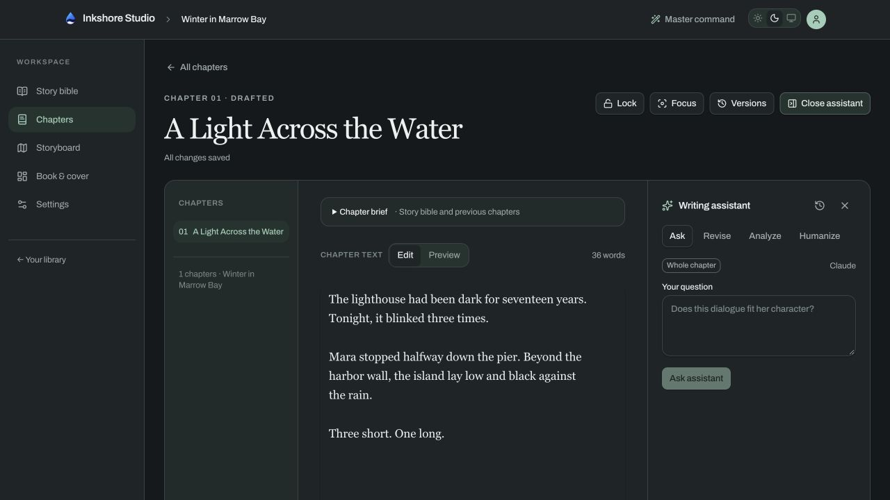

# Inkshore Studio

An open-source workspace for planning, writing, and revising long-form fiction.
Keep a story bible beside your chapters, develop ideas on a storyboard, and
export a finished manuscript. AI assistance is optional and runs only when you
request it.

[Desktop releases](https://github.com/AashishKumar-3002/inkshore-studio/releases) · [Running from source](#running-from-source) · [Report an issue](https://github.com/AashishKumar-3002/inkshore-studio/issues)



## What you can do

- **Plan a story:** capture characters, setting, plot, tone, and voice in a story bible. Import existing Markdown or text notes.
- **Write chapters:** start from an idea, write directly, or import a draft. Mark chapters final and lock work you want to protect.
- **Revise with control:** ask questions, request revisions, or analyze a chapter. Review proposed changes before applying them, and return to saved versions.
- **Explore visually:** arrange notes and draw on a freeform storyboard.
- **Prepare a book:** set title and author details, create cover art with an OpenAI API key, and export Markdown, PDF, or EPUB.

Inkshore supports light, dark, and system themes.

## Desktop and web

| | Desktop app | Self-hosted web app |
| --- | --- | --- |
| Library | Local PGlite database | PostgreSQL |
| Sign-in | No account required | Account-based access |
| AI | API keys or local Claude/Codex subscription sign-in | API keys |
| Setup | Published installer or source build | Node.js, PostgreSQL, and environment configuration |

The [Releases page](https://github.com/AashishKumar-3002/inkshore-studio/releases)
lists available installers. The release workflow targets macOS (Apple Silicon
and Intel), Windows x64, and Linux x64; an installer is available only after
its release is published. Packaged desktop builds include the app server and
database, so they do not require a separate Node.js or PostgreSQL installation.

**Preview limitations:** desktop builds are currently unsigned and may trigger
operating-system warnings. Automatic updates, device sync, mobile apps, and
real-time collaboration are not available. Desktop libraries stay on their
respective computers.

## AI and your writing

Writing, organizing, importing, and exporting do not require an AI provider. For AI actions, select a provider in project **Settings**:

| Provider | Access |
| --- | --- |
| Anthropic Claude, OpenAI, OpenRouter, NVIDIA NIM | API key; desktop and web |
| Claude or Codex subscription | Local sign-in; desktop only |

Subscription access uses the account signed in on your computer and is subject
to that plan's usage limits. These modes support text; cover generation
currently requires an OpenAI API key. Provider API keys are encrypted at rest.

The desktop library is local, but AI requests send the relevant writing to the
provider you select. Review your provider's data terms before using AI with
private material.

## Get started

1. Create a project and add story bible notes, or import notes you already have.
2. Write a chapter, upload a draft, or create one from an idea.
3. If you want AI help, configure a provider in **Settings**. You can review a proposed revision before applying it.
4. Set book details and export your manuscript when it is ready.

## Running from source

Use **Node.js 22** and npm:

```bash
git clone https://github.com/AashishKumar-3002/inkshore-studio.git
cd inkshore-studio
npm ci
```

### Desktop

```bash
npm ci --prefix desktop
npm run desktop
```

This builds the app and opens Electron. The desktop shell creates its local
library and secrets on first run. To reopen an existing build without
rebuilding, run `npm --prefix desktop start`.

### Web

The web app requires PostgreSQL. Copy `.env.example` to `.env.local`, set
`DATABASE_URL`, and generate the required secrets:

```bash
openssl rand -base64 32 # AUTH_SECRET
openssl rand -hex 32    # ENCRYPTION_KEY
```

Add the generated values to `.env.local`, then run:

```bash
npm run db:migrate
npm run dev
```

Open [localhost:3000](http://localhost:3000). See [`.env.example`](.env.example)
for optional OAuth and provider-key configuration. Back up an existing database
before applying migrations.

### Validate changes

```bash
npm run typecheck
npx eslint src scripts tests
npm test
npm run build
```

For desktop startup or packaging changes, also run `npm run desktop:prepare`
and `node scripts/smoke-desktop.mjs`. See
[desktop release documentation](docs/releases.md) for build and publishing
details.

## Project structure

| Path | Purpose |
| --- | --- |
| `src/app/` | Pages and API routes |
| `src/components/` | Shared interface components |
| `src/lib/` | AI providers, data access, authentication, and exports |
| `desktop/` | Electron shell and installer configuration |
| `drizzle/` | Database migrations |
| `tests/` | Automated tests |

The app is built with Next.js 16, React, TypeScript, Tailwind CSS, Electron,
Drizzle ORM, and Auth.js.

## Contributing and license

Bug reports, UX feedback, and focused pull requests are welcome. Read
[CONTRIBUTING.md](CONTRIBUTING.md) before submitting a change. Do not include
private manuscript text, API keys, or account details in public issues.

Inkshore Studio is licensed under the [MIT License](LICENSE). Copyright © 2026 Aashish Kumar.
